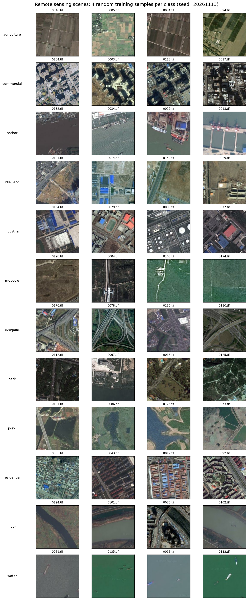

# 遥感图像分类数据探查

检查日期：2026-11-13。数据根目录为项目内的 `data/raw/`；本次仅读取原始数据，没有修改 `data/` 下的文件。使用项目 `.venv` 中的 `tifffile` 解码检查全部影像。

## 目录与数量

```text
data/
└── raw/
    ├── sample_submission.csv                 # 提交示例，240 行数据
    ├── data/
    │   ├── Google dataset of SIRI-WHU_read me.doc
    │   └── 12class_tif/                      # 训练集：2160 张
    │       ├── agriculture/                  # 180 张 tif
    │       ├── commercial/                   # 180 张 tif
    │       ├── harbor/                       # 180 张 tif
    │       ├── idle_land/                    # 180 张 tif
    │       ├── industrial/                   # 180 张 tif
    │       ├── meadow/                       # 180 张 tif
    │       ├── overpass/                     # 180 张 tif
    │       ├── park/                         # 180 张 tif
    │       ├── pond/                         # 180 张 tif
    │       ├── residential/                  # 180 张 tif
    │       ├── river/                        # 180 张 tif
    │       └── water/                        # 180 张 tif
    └── test/
        ├── class_id_mapping.txt
        └── 12class_tif/                      # 无标签测试集：240 张 tif
```

此外，`raw/` 和 `raw/data/` 各有一个 macOS 的 `.DS_Store` 文件；不属于影像数据。训练集各类别数量相等，测试集共 240 张。

## 影像格式与 20 张随机样本

以下从训练集随机取 16 张、测试集随机取 4 张；两个样本池分别按路径排序后使用 Python `random.Random` 的种子 `20261113` 和 `20261114` 抽取。尺寸按高×宽表示，取值范围是该文件所有像素和波段的实际最小值与最大值。

| 集合 | 路径（相对 `data/raw/`） | 尺寸 | 波段数 | 类型 | 实际范围 |
|---|---|---:|---:|---|---:|
| 训练 | `data/12class_tif/agriculture/0040.tif` | 200×200 | 3 | uint8 | 1–180 |
| 训练 | `data/12class_tif/agriculture/0075.tif` | 200×200 | 3 | uint8 | 0–164 |
| 训练 | `data/12class_tif/agriculture/0128.tif` | 200×200 | 3 | uint8 | 8–255 |
| 训练 | `data/12class_tif/commercial/0019.tif` | 200×200 | 3 | uint8 | 6–255 |
| 训练 | `data/12class_tif/commercial/0034.tif` | 200×200 | 3 | uint8 | 0–255 |
| 训练 | `data/12class_tif/commercial/0090.tif` | 200×200 | 3 | uint8 | 14–255 |
| 训练 | `data/12class_tif/harbor/0030.tif` | 200×200 | 3 | uint8 | 23–255 |
| 训练 | `data/12class_tif/harbor/0090.tif` | 200×200 | 3 | uint8 | 34–255 |
| 训练 | `data/12class_tif/harbor/0176.tif` | 200×200 | 3 | uint8 | 56–214 |
| 训练 | `data/12class_tif/idle_land/0003.tif` | 200×200 | 3 | uint8 | 13–255 |
| 训练 | `data/12class_tif/industrial/0012.tif` | 200×200 | 3 | uint8 | 29–255 |
| 训练 | `data/12class_tif/overpass/0169.tif` | 200×200 | 3 | uint8 | 7–255 |
| 训练 | `data/12class_tif/pond/0052.tif` | 200×200 | 3 | uint8 | 0–255 |
| 训练 | `data/12class_tif/pond/0164.tif` | 200×200 | 3 | uint8 | 27–234 |
| 训练 | `data/12class_tif/river/0076.tif` | 200×200 | 3 | uint8 | 27–255 |
| 训练 | `data/12class_tif/water/0131.tif` | 200×200 | 3 | uint8 | 58–255 |
| 测试 | `test/12class_tif/0017.tif` | 200×200 | 3 | uint8 | 74–255 |
| 测试 | `test/12class_tif/0062.tif` | 200×200 | 3 | uint8 | 2–255 |
| 测试 | `test/12class_tif/0142.tif` | 200×200 | 3 | uint8 | 29–123 |
| 测试 | `test/12class_tif/0151.tif` | 200×200 | 3 | uint8 | 1–235 |

全量 2400 张的检查结果：全部是单页、3 波段 `uint8` 图像，总体像素范围为 **0–255**，没有 `uint16` 图像。**2399 张尺寸为 200×200，另有 1 张尺寸为 190×200**：`data/raw/data/12class_tif/pond/0002.tif`，范围 10–216。这张可正常读取，但后续批量训练时应在读取后统一尺寸；不应更改原文件。

## 完整性检查

对全部 2160 张训练图及 240 张测试图执行了 `tifffile.TiffFile(...).asarray()`，并计算像素最小值、最大值；**读取失败、空图和解码异常数为 0**。这说明当前文件均可完整解码；不等同于已验证场景标签是否准确。

## 类别映射与提交格式

`data/raw/test/class_id_mapping.txt` 是逗号分隔的文本表，表头为 `class_id,original_class`。训练集文件夹名称通过 `original_class` 映射到提交所需的整数类别 ID：

| class_id | original_class | 训练图片数 |
|---:|---|---:|
| 0 | agriculture | 180 |
| 1 | commercial | 180 |
| 2 | harbor | 180 |
| 3 | idle_land | 180 |
| 4 | industrial | 180 |
| 5 | meadow | 180 |
| 6 | overpass | 180 |
| 7 | park | 180 |
| 8 | pond | 180 |
| 9 | residential | 180 |
| 10 | river | 180 |
| 11 | water | 180 |

`data/raw/sample_submission.csv` 是 CSV，有 **240 行数据**，第一列 `image_id` 是带 `.tif` 扩展名的测试图文件名，第二列的**实际列名为 `predicted_class_id `（末尾包含一个空格）**。生成提交文件时应沿用样例的列名及行顺序，并填入 0–11 的类别 ID。样例中 `0001.tif` 的值为 `4`、`0002.tif` 的值为 `8`，其余行为空；这两个值只是样例内容，不能当成真实标签。240 行文件名全部唯一，且与测试集 240 张 tif 一一对应，无缺失或多余项。评价指标为准确率。

## 类别图示

每类从训练集按文件名排序后，以随机种子 `20261113` 取 4 张，按类别分行组成 12×4 网格。图上标有类别与文件名，可用于初步观察外观差异；这些样本仅用于展示，不能代表全部类内变化。

